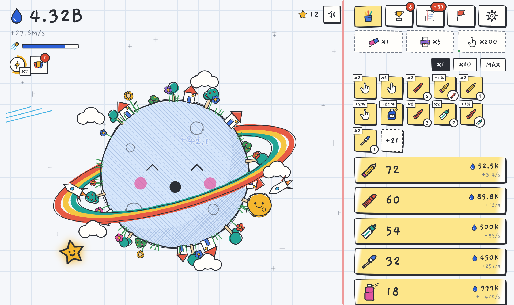
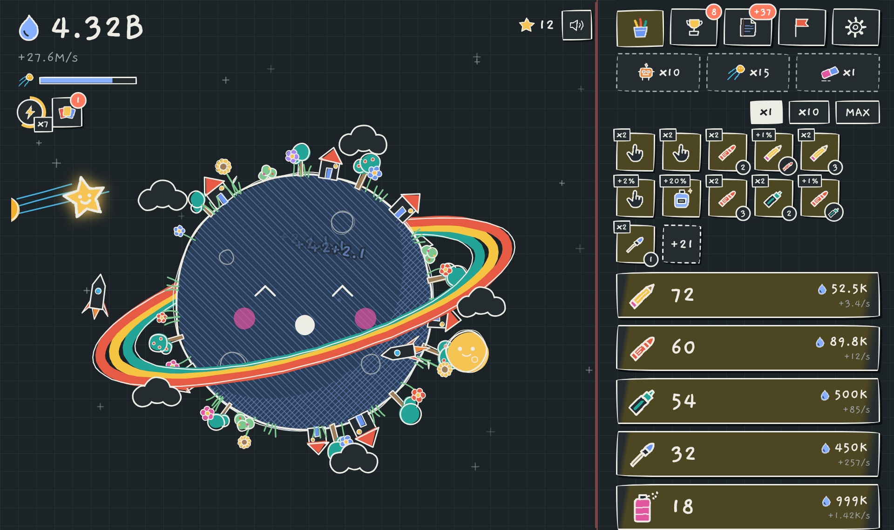
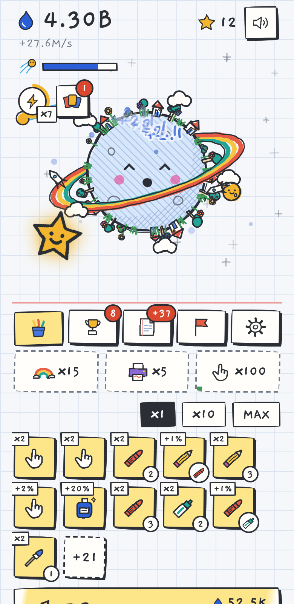

# 铅笔小星球 · Pencil Planet

一个手绘涂鸦风的增量 / 放置小游戏。在笔记本纸上点一颗小星球产出墨水，雇佣会自己画画的文具，看着星球一点点长满花草、房子、火箭和彩虹环。

界面几乎不用文字：信息都由图标和数字表达，名称只在鼠标悬停或长按时以小气泡出现。



| 暗色（黑板） | 手机 |
| --- | --- |
|  |  |

## 怎么玩

- **点星球**：产出墨水。按住星球左右拖动可以让它转起来。
- **买文具**：共 10 种文具，从铅笔到星河，都会自动产出墨水。每种文具都会在星球上画出对应的装饰，满 50 个后装饰还会升级成第二形态。
- **升级**：升级格会自动出现。有翻倍升级、协同升级（相邻两种文具互相加成）、点击升级和墨水品质升级。
- **金色星星**：会随机出现，点到后随机触发一种效果：一大笔墨水、产量 ×7，或点击 ×77。
- **橡皮人**：会沿着星球边缘走，擦掉经过的涂鸦，点中它有奖励。
- **小任务**：同时挂着 3 个纯图标任务。完成后点一下领取奖励。
- **三选一卡牌**：每一局墨水每到一个新的数量级（每两个数量级一次）就能选一张卡。卡分点击流、挂机流、金星流三派。
- **翻页**：清空当前这一局，换取金星贴纸。每张贴纸永久提高产量，贴纸也能拿来买特权。
- **挑战**：6 个带限制条件的关卡，每过一关解锁一种星球皮肤。
- **换本子**：攒够 10000 张贴纸后可以换本子（第二层转生）。会获得回形针，并解锁新的纸张：牛皮纸、黑卡纸、蓝图纸。
- **彩蛋**：星球上藏着 6 个隐藏成就，试着点点上面的东西。

游戏会自动存档到浏览器。离线期间也有收益：默认按 50% 计算，最多累计 8 小时。设置页可以导出和导入存档。

## 在本地运行

整个游戏就是一个 `index.html`，没有构建步骤。用浏览器直接打开即可。

手写字体（Gaegu、ZCOOL KuaiLe）从 Google Fonts 加载。离线时会回退到系统字体，不影响游戏。

## 文件结构

```
index.html        游戏本体（HTML + CSS + JS，单文件）
docs/design.md    设计文档：数值、系统、公式
tools/sim.js      节奏模拟器
screenshots/      README 用的截图
```

## 数值模拟

改动数值后，可以用模拟器检查节奏：

```bash
node tools/sim.js active    # 积极玩家：前 30 分钟每秒点 4 次，会抓金星
node tools/sim.js nogold    # 同上，但不抓金星
node tools/sim.js clicky    # 每秒点 8 次
```

输出是第一、二、三局中，累计墨水每到一个数量级时的时间（单位：分钟）。

## 技术说明

- 星球和装饰用 Canvas 绘制。所有线条都带轻微抖动，并每隔约 140 ms 换一次抖动形状，模拟手绘动画里线条“颤动”的效果。
- 界面图标是内联 SVG，叠加了 `feTurbulence` 置换滤镜，让图标看起来是手画的。
- 支持亮色、暗色主题，跟随系统设置。会尊重系统的“减弱动态效果”设置。
- 音效全部由 Web Audio 实时合成，没有音频文件。
